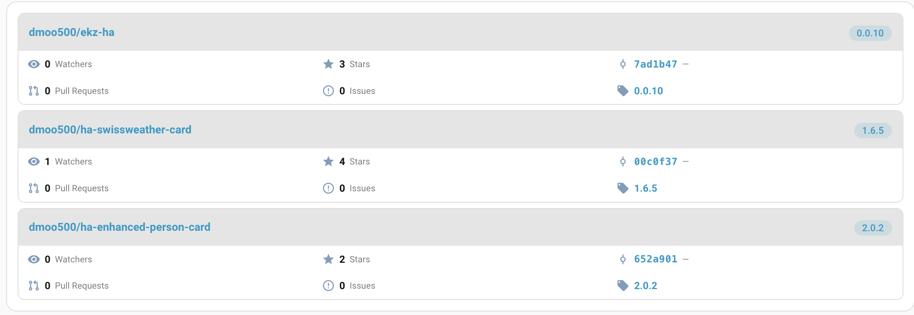
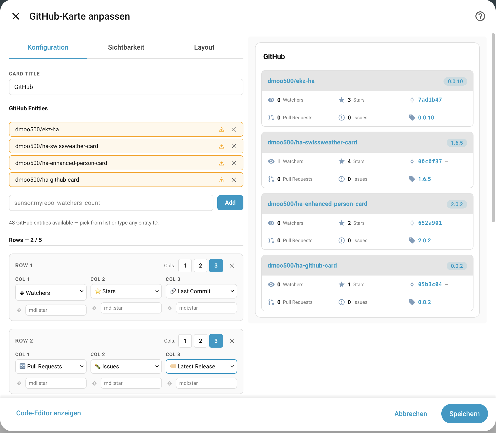
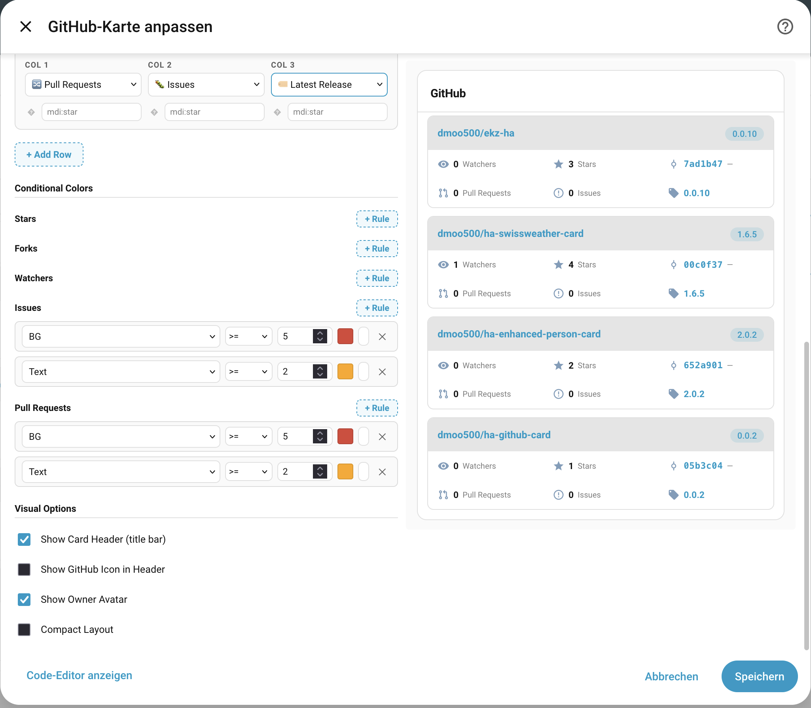

# ha-github-card

[](https://github.com/hacs/integration)
[](https://github.com/dmoo500/ha-github-card/releases)
[](LICENSE)
[](https://github.com/dmoo500/ha-github-card/issues)
[](https://github.com/dmoo500/ha-github-card/stargazers)
[](https://github.com/dmoo500/ha-github-card/watchers)
[](https://github.com/dmoo500/ha-github-card/commits/main)
[](https://github.com/dmoo500/ha-github-card)
[](https://www.typescriptlang.org/)

A custom [Home Assistant](https://www.home-assistant.io/) Lovelace card that displays information from your GitHub repositories tracked via the official [GitHub integration](https://www.home-assistant.io/integrations/github/).



## Contents

- [Features](#features)
- [Requirements](#requirements)
- [Installation](#installation)
- [GitHub Card](#github-card)
- [Activity Chart](#activity-chart)
- [Theming](#theming)
- [Development](#development)

## Features

- **GitHub Card** — table-like layout per repository: owner avatar, repo name, latest release tag
- Fully configurable stat rows — up to 5 rows with 1–3 columns each
- Available stats: Stars, Forks, Watchers, Issues, Pull Requests, Last Commit, Latest Release
- **Conditional color rules** per stat column — color text or background based on a threshold
- **Activity chart** — new commits, pull requests, issues and (optionally) discussions per day for the last 7 days, as a line or stacked bar chart
  - below each repository table of the GitHub Card, or
  - as a standalone **GitHub Activity Card** per repository
- Visual editors for both cards (entity picker, row/column configurator, color rule builder, activity chart options)
- Owner avatar auto-derived from the repository name
- Compact layout option
- Fully themed via HA CSS variables

## Requirements

1. [GitHub integration](https://www.home-assistant.io/integrations/github/) installed and configured in Home Assistant
2. At least one repository added to the GitHub integration
3. For the activity chart only: the [recorder](https://www.home-assistant.io/integrations/recorder/) (enabled by default) and the repository's *Latest commit / pull request / issue / discussion* sensors enabled — see [Activity Chart](#activity-chart)

## Installation

### HACS (recommended)

[](https://my.home-assistant.io/redirect/hacs_repository/?owner=dmoo500&repository=ha-github-card&category=lovelace)

1. Open HACS → Frontend → "+ Explore & download repositories"
2. Search for **ha-github-card** and install
3. Add the resource if needed: `/hacsfiles/ha-github-card/ha-github-card.js`

Pre-releases (e.g. `0.1.0-beta.1`) are only offered by HACS when *Show beta versions* is enabled for this repository.

### Manual

1. Download `ha-github-card.js` from the [latest release](https://github.com/dmoo500/ha-github-card/releases)
2. Copy it to `config/www/ha-github-card/ha-github-card.js`
3. Add the resource in Settings → Dashboards → Resources: `/local/ha-github-card/ha-github-card.js`

The loaded version is printed to the browser console (`GITHUB-CARD <version>`), which helps to verify that the browser cache picked up an update.

## GitHub Card

### Via Visual Editor

Click the edit button on a dashboard, add a new card, search for **GitHub Card**.



Use the entity input to select any sensor from a GitHub repository device (e.g. `sensor.myrepo_watchers_count`). The card automatically aggregates all sensors from the same device.

Configure rows and columns freely — each row can have 1, 2 or 3 stat slots. The *Activity Chart* section of the editor enables the [activity chart](#activity-chart) below each repository.

#### Conditional Colors



Add color rules per stat slot. Each rule has:
- **Text / BG** — apply the color to the value text or the cell background
- **Operator** — `>`, `>=`, `<`, `<=`, `==`
- **Threshold** — the numeric value to compare against
- **Color** — any CSS color string

The first matching rule wins.

### YAML

```yaml
type: custom:ha-github-card
title: GitHub
entities:
  - sensor.myrepo_watchers_count   # any sensor from the GitHub device works
show_avatar: true
show_header: true
show_header_icon: true
compact: false
rows:
  - [watchers, stars, last_commit]
  - [pull_requests, issues]
show_activity: true                # optional activity chart below each repository
```

### All Options

| Option                | Type      | Default   | Description                                                                 |
|-----------------------|-----------|-----------|-----------------------------------------------------------------------------|
| `title`               | `string`  | —         | Card header title (the header is only shown when a title is set)            |
| `entities`            | `list`    | `[]`      | One entity ID per GitHub repository (any sensor from the device)            |
| `show_avatar`         | `boolean` | `true`    | Show repository owner avatar                                                |
| `show_header`         | `boolean` | `true`    | Show the card header bar                                                    |
| `show_header_icon`    | `boolean` | `true`    | Show the GitHub icon in the card header                                     |
| `compact`             | `boolean` | `false`   | Compact layout with reduced padding                                         |
| `rows`                | `list`    | see below | List of up to 5 rows, each a list of 1–3 [slot keys](#available-slot-keys) |
| `icons`               | `map`     | —         | Per-slot icon override (e.g. `stars: mdi:star-outline`)                     |
| `slot_colors`         | `map`     | —         | Per-slot [conditional color rules](#conditional-color-rules)                |
| `show_activity`       | `boolean` | `false`   | Show the [activity chart](#activity-chart) below each repository            |
| `activity_range`      | `string`  | `7d`      | Activity chart [time range](#activity-chart-options)                        |
| `activity_metrics`    | `list`    | `[commits, pull_requests, issues]` | Activity chart [metrics](#activity-chart-options)  |
| `activity_chart_type` | `string`  | `line`    | Activity chart type: `line` or `bar` (stacked bars)                         |

**Default rows:**
```yaml
rows:
  - [watchers, stars, last_commit]
  - [pull_requests, issues]
```

The deprecated options `row2_slots` / `row3_slots` of older versions are still read and converted to `rows`.

### Available Slot Keys

| Key             | Description                    |
|-----------------|--------------------------------|
| `stars`         | Stargazer count                |
| `forks`         | Fork count                     |
| `watchers`      | Watcher count                  |
| `issues`        | Open issue count               |
| `pull_requests` | Open pull request count        |
| `last_commit`   | Latest commit SHA + date       |
| `last_release`  | Latest release tag             |
| `none`          | Empty slot (hidden)            |

### Conditional Color Rules

Color rules can be defined per numeric slot. The first matching rule applies.

```yaml
slot_colors:
  stars:
    - op: ">="
      value: 100
      color: "var(--success-color, #4caf50)"
      type: background
    - op: ">="
      value: 10
      color: "var(--warning-color, #ff9800)"
      type: text
  issues:
    - op: ">="
      value: 20
      color: "var(--error-color, #f44336)"
      type: background
    - op: ">="
      value: 1
      color: "var(--warning-color, #ff9800)"
      type: text
```

**Rule fields:**

| Field   | Type     | Description                                              |
|---------|----------|----------------------------------------------------------|
| `op`    | `string` | Operator: `>`, `>=`, `<`, `<=`, `==`                     |
| `value` | `number` | Threshold to compare against                             |
| `color` | `string` | CSS color — hex, named, or HA variable                   |
| `type`  | `string` | `text` (default) or `background`                         |

Supported slots for color rules: `stars`, `forks`, `watchers`, `issues`, `pull_requests`

## Activity Chart

The activity chart shows how many new **commits**, **pull requests**, **issues** and (optionally) **discussions** appeared per day. It is derived from the Home Assistant history of the GitHub integration's *Latest commit*, *Latest pull request*, *Latest issue* and *Latest discussion* sensors — no additional sensors or GitHub tokens are needed. The sensors are discovered automatically from the repository device.

It is available as a **line chart** (default, one line per metric) or as **stacked bars**. Hovering a day shows its exact counts, and the legend shows the totals for the period.

The last day is **today** and updates live. Because it is still in progress, it is marked: the axis shows *Today* (localized), the line towards it is dashed with hollow points, and its bar is drawn faded.

### Below each repository (GitHub Card)

Enable it in the *Activity Chart* section of the GitHub Card editor, or via YAML:

```yaml
type: custom:ha-github-card
entities:
  - sensor.myrepo_stars
show_activity: true
activity_range: 7d
activity_chart_type: line
activity_metrics: [commits, pull_requests, issues]
```

### GitHub Activity Card (standalone)

One card per repository, available in the card picker as **GitHub Activity Card** (with visual editor):

```yaml
type: custom:ha-github-activity-card
entity: sensor.myrepo_latest_commit   # any sensor of the repository device
title: My Repo                        # optional, defaults to the repository name
show_header: true
show_header_icon: true
activity_range: 7d
activity_chart_type: line             # or "bar"
activity_metrics: [commits, pull_requests, issues, discussions]
```

| Option             | Type      | Default          | Description                                       |
|--------------------|-----------|------------------|---------------------------------------------------|
| `entity`           | `string`  | — (required)     | Any entity ID of the GitHub repository device     |
| `title`            | `string`  | repository name  | Card header title                                 |
| `show_header`      | `boolean` | `true`           | Show the card header bar                          |
| `show_header_icon` | `boolean` | `true`           | Show the GitHub icon in the card header           |
| `activity_*`       |           |                  | See [Activity Chart Options](#activity-chart-options) |

### Activity Chart Options

Shared by both cards:

| Option                | Values                                                  | Default                            |
|-----------------------|---------------------------------------------------------|------------------------------------|
| `activity_range`      | `7d`                                                    | `7d`                               |
| `activity_metrics`    | `commits`, `pull_requests`, `issues`, `discussions`     | `[commits, pull_requests, issues]` |
| `activity_chart_type` | `line` (one line per metric), `bar` (stacked bars)      | `line`                             |

Days are based on the browser's local time zone.

### Limitations

- Only activity recorded by Home Assistant is shown. The recorder must keep history for the *Latest …* sensors (including attributes) for the whole range — check `purge_keep_days` and recorder excludes. Disabled sensors are not shown.
- The integration polls GitHub periodically, so several commits/issues created between two updates are counted as one.
- Closing the newest issue or pull request is not counted as activity.

## Theming

Both cards follow the active Home Assistant theme. The following CSS variables can be overridden, e.g. with [card-mod](https://github.com/thomasloven/lovelace-card-mod) or in a theme:

| Variable                            | Default                             | Used for                            |
|-------------------------------------|-------------------------------------|-------------------------------------|
| `--gh-accent`                       | `--primary-color`                   | Accent color                        |
| `--gh-text`                         | `--primary-text-color`              | Primary text                        |
| `--gh-text-sec`                     | `--secondary-text-color`            | Labels and secondary text           |
| `--gh-border`                       | `--divider-color`                   | Borders                             |
| `--gh-bg-row1`                      | `--secondary-background-color`      | Repository header row background    |
| `--gh-link`                         | `--primary-color`                   | Repository links                    |
| `--gh-activity-commits-color`       | `#2da44e`                           | Activity chart: commits             |
| `--gh-activity-pull-requests-color` | `#8250df`                           | Activity chart: pull requests       |
| `--gh-activity-issues-color`        | `#d4a72c`                           | Activity chart: issues              |
| `--gh-activity-discussions-color`   | `#0969da`                           | Activity chart: discussions         |
| `--gh-activity-chart-height`        | `64px`                              | Activity chart height               |

## Development

Requires Node.js 20+ and Yarn 4 (via Corepack).

```bash
corepack enable
yarn install
yarn build        # production build → ha-github-card.js
yarn dev          # rebuild on change
yarn type-check   # TypeScript check
yarn lint         # ESLint
yarn format       # Prettier (format:check in CI)
yarn validate     # TypeScript, ESLint, formatting, and README badges
yarn validate:badges # Check badge links and the TypeScript major version offline
yarn test         # Regression tests
```

CI also checks the README badges. Update the static TypeScript badge when upgrading to a new major version.

### Adding activity time ranges, metrics or chart types

Time ranges, metrics and chart types are defined in registries in `src/utils/activity.ts`. To add e.g. a 30-day range, extend the `ActivityRangeKey` type in `src/types/index.ts` and add an entry to `ACTIVITY_RANGES` — the editors, the chart and both cards pick it up automatically. Metrics work the same way via `ActivityMetricKey` and `ACTIVITY_METRICS`. New chart types need an `ActivityChartType` member, an `ACTIVITY_CHART_TYPES` entry and a renderer in `_chartRenderers` of `src/components/github-activity-chart.ts` (enforced by the type checker).

### Releases

Changes are tracked in [CHANGELOG.md](CHANGELOG.md). A release is created on GitHub with the version as tag (e.g. `0.1.0`, pre-releases like `0.1.0-beta.1` with *Set as a pre-release*); the CI workflow then attaches the built `ha-github-card.js` and a zip archive.

## License

[MIT](LICENSE)
